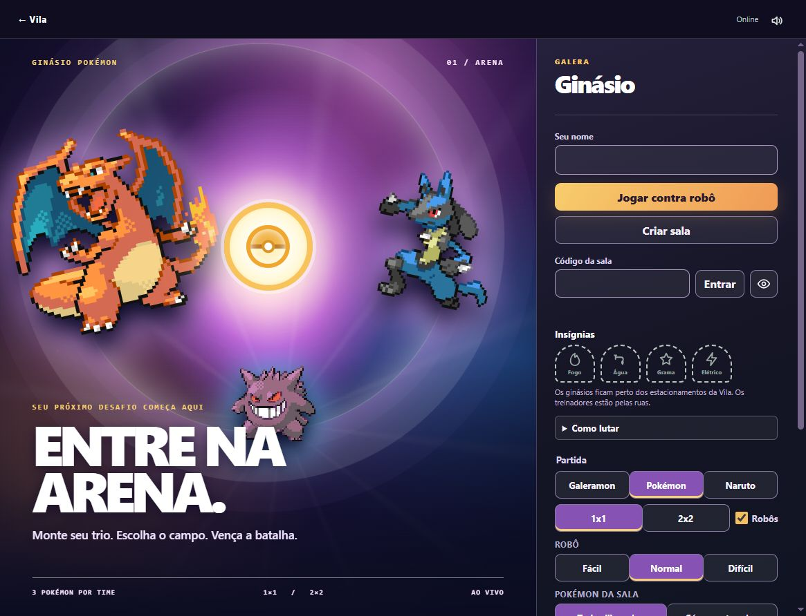

# Admin Pokémon e lobby do Ginásio

## O que muda

- Novo painel separado em `/admin/pokemon`, protegido pelo login GitHub da moderação. O administrador escolhe três Pokémon diferentes para cada líder ou treinador da Vila e pode restaurar o trio original.
- Os times editados ficam no SQLite (`ginasio_times_pokemon`). O servidor usa os novos times nas próximas batalhas e o Ginásio mostra a mesma composição ao jogador.
- O lobby do modo Pokémon ganha arena violeta, portal iluminado, criaturas em destaque e painel responsivo. Galeramon, Naruto e a tela de batalha mantêm seu visual.

## Verificação

- Revisão do diff e `git diff --check`.
- Conferência visual no navegador com captura de tela.
- Testes automatizados não executados, conforme pedido anterior.
