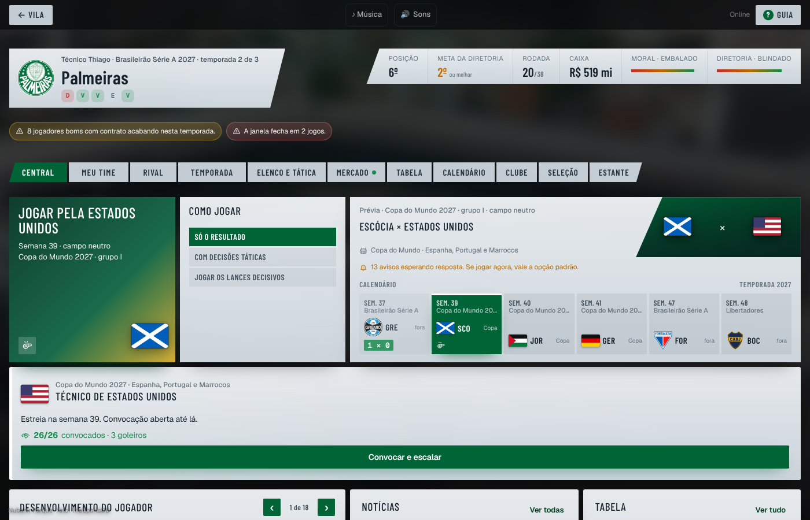
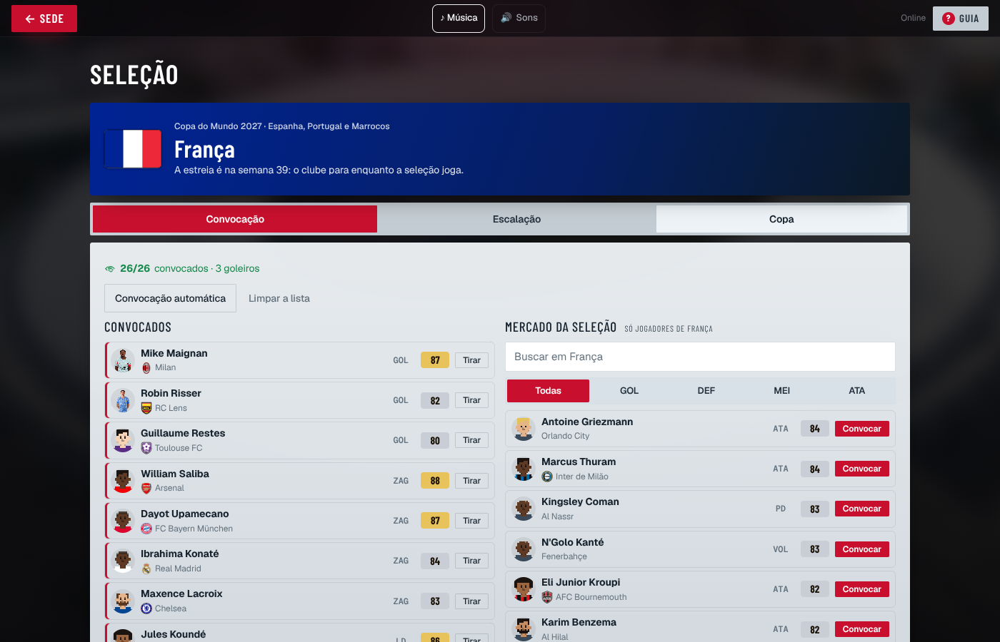
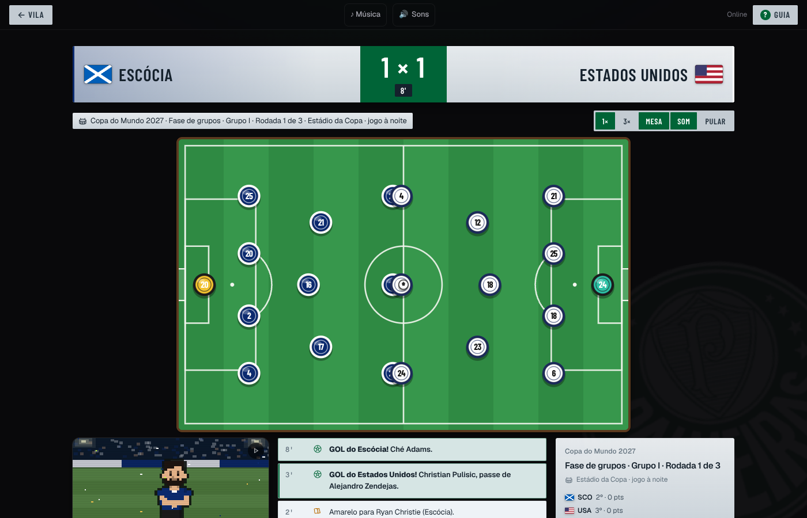
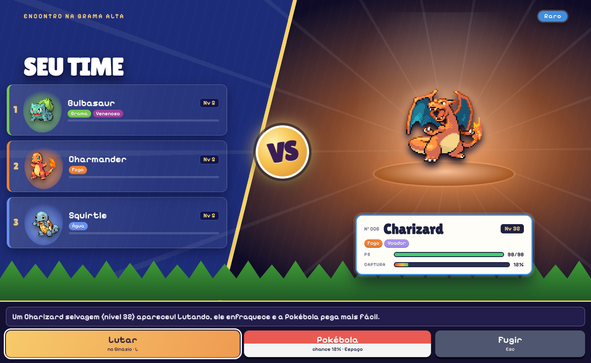
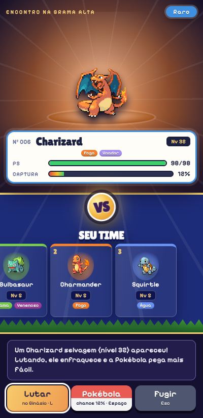
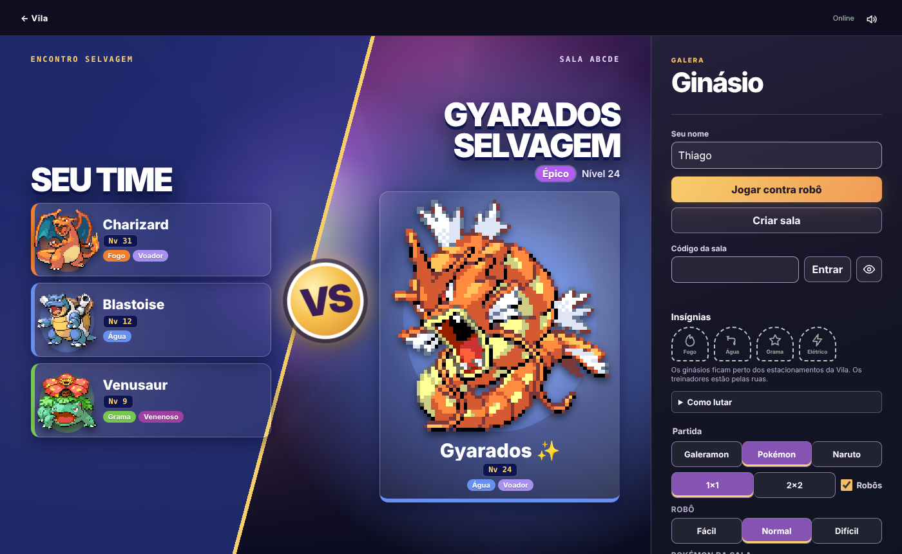
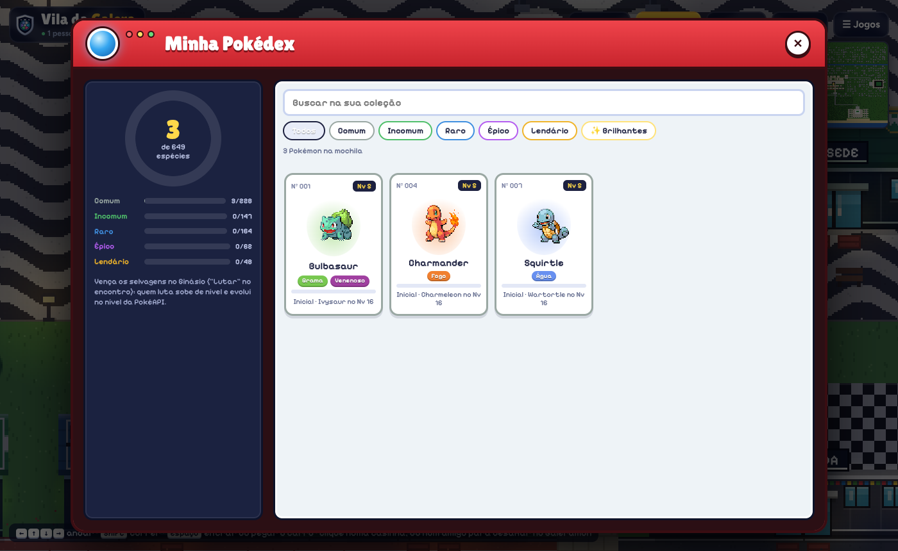
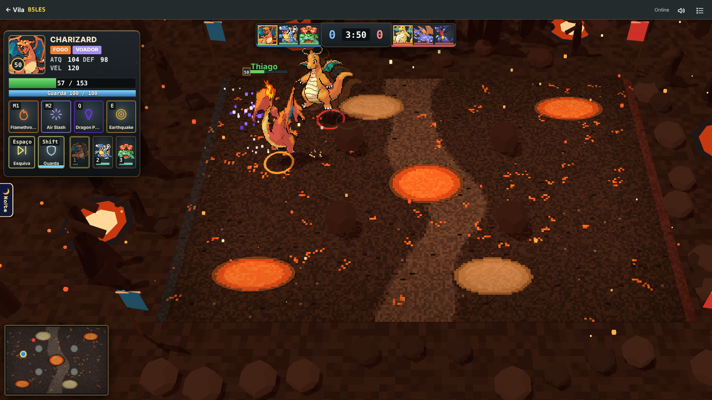

# Copa do Mundo na Carreira, painel com os atributos certos, telas Pokémon novas, a Pokédex no admin e o Pokémon que parava no Ginásio

## Copa do Mundo na Carreira (solo e sala)

- **De 2 em 2 temporadas** (na 2ª, na 4ª...) tem Copa do Mundo. O futebol de clubes **para no meio da temporada** (semana 39, depois da rodada 19 do Brasileirão) e tudo o que vinha depois anda 8 semanas, na mesma ordem. A rodada da janela continua pela semana do Brasileirão, então a Copa cai na janela do meio do ano e nada do calendário se cruza.
- **Formato novo:** 48 seleções em 4 potes pela força, 12 grupos de 4 em turno único, os 2 primeiros e os 8 melhores terceiros nos 16 avos, depois oitavas, quartas, semifinal, disputa de 3º lugar e final, tudo em jogo único e em campo neutro.
- **As seleções saem do EA FC 27** (`ferramentas/base-selecoes.js` → `public/carreira/base/selecoes-2026.js`): os jogadores da carreira com o país (com a nota de agora, os jovens da base também) e os de fora das ligas da carreira (MLS, Arábia, Portugal...). Onde o CSV tem pouca gente (Catar, Irã, Jordânia), entram fictícios no nível da seleção.
- **A proposta:** no começo da temporada da Copa, cada técnico recebe **uma** seleção, pela campanha da temporada anterior (posição na liga pesada pela força da liga, títulos, a meta da diretoria). Na sala, a melhor campanha escolhe primeiro e ninguém repete seleção. Pop-up, aviso na caixa de entrada e o painel da Seleção na Sede, com Aceitar e Recusar; sem resposta, a seleção é aceita quando a pausa chega.
- **Convocação = o mercado da seleção:** só aparecem jogadores do país, na tela **Seleção** e no novo modo "Seleção" do Mercado. 26 nomes, pelo menos 3 goleiros; a lista do computador já vem pronta e fecha na estreia (incompleta, completa sozinha).
- **Os jogos da seleção** usam o mesmo motor e as mesmas decisões da carreira (paradas táticas, lances decisivos, pênaltis), no solo e na rodada ao vivo da sala (o técnico decide pela seleção dele; dois técnicos com seleções podem se enfrentar). Sem bilheteria, salário nem moral do clube; os gols ficam só na artilharia da Copa; dois amarelos ou um vermelho suspendem na Copa; a lesão vale no clube. A partida mostra as bandeiras, as camisas da seleção e "campo neutro".
- O histórico do técnico guarda a campanha da seleção; a Tabela ganha a aba da Copa (12 grupos e a chave); a festa do campeão traz os convocados.

## Consertos da Carreira

- **O teste do mercado que falhava na main:** `comNota` guardava a nota de base em `base`, a mesma chave que marca o garoto da base; o mercado avaliava todo jogador a 40% do valor (a venda na hora saía bem abaixo). A nota de base agora vai em `notaBase`.
- **Painel de moderação:** o atributo editado não batia com o jogo. Agora o painel lê e grava no número que a figurinha mostra (a figurinha soma a evolução da nota), e no Rumo ao Estrelato (e nos jovens da base) o atributo muda no próprio atleta, sem ficar travado por cima do treino.
- Os testes de `carreira-clube` não dependem mais da sorte da semente (às vezes a diretoria demitia o técnico no meio do teste); `salas-esperado.json` ganhou o campo `temporada` que já estava no main.

## Telas Pokémon

- **Encontro na grama alta**, refeito em CSS: o seu time de um lado (cartas com tipo, nível e experiência), o selvagem do outro no holofote (número, tipos, PS e a chance da Pokébola), VS no meio e as ações embaixo. No celular, empilhado.
- **Antes da luta no Ginásio** (líder ou selvagem): a prévia ocupa a arena inteira do lobby, no mesmo jeito.
- **Pokédex da Vila**: aparelho vermelho com o anel das espécies, as raridades, o ranking, busca, filtros e cartas.
- **HUD da batalha** maior no PC (cresce com a tela).

## Admin da Pokédex

- `/admin/pokedex` (mesmo login do GitHub e CSRF do painel da carreira): todos os treinadores, com busca. Para cada Pokémon: nível, experiência, espécie, brilhante e "evoluir pelo nível"; dar e tirar Pokémon; pôr todos de um treinador num nível. Vale na hora (a Vila e o Ginásio leem o banco). Cada edição fica registrada (`moderacao_pokemon`, migração 011) e aparece em "Últimas edições".

## Ginásio: o Pokémon que parava

- **Depois da Pokébola:** a cena da bola pausa a luta e empurra o relógio (`start`) para a frente. O navegador usava o `start` como a identidade da partida, então achava que era uma luta nova, limpava a rede e voltava a contar os comandos do zero; o servidor recusa sequência repetida, e o Pokémon ficava parado até o fim. Agora a partida tem um `id` (e o `comeco`, para a contagem do início), que a Pokébola não muda.
- **Na parede:** o robô recuava direto contra a borda e ficava ali, apanhando sem reagir (7 vezes em 40 lutas de teste). Perto da parede ele não empurra mais para fora: desliza ao longo dela e volta para o meio (`longeDaParede` em `regras.js`). Sem o travamento o robô ficou mais forte; o fácil e o normal ganharam um pouco mais de pausa e de erro na mira para voltar ao nível medido de antes (quem recua atirando ganha 95% do fácil e ~43% do normal).
- Testes: a luta segue com o mesmo `id` e o Pokémon anda depois da bola que escapou (`tests/ginasio-selvagem.test.js`), e o robô não fica colado na parede (`tests/ginasio-equilibrio.test.js`).

## Verificação

- `npm test` (inclui os novos `tests/carreira-copa.test.js` e `tests/admin-pokedex.test.js`).
- Conferência no navegador: Sede, Seleção, Mercado, partida da seleção, encontro, versus do Ginásio, Pokédex, HUD e o painel da Pokédex.
