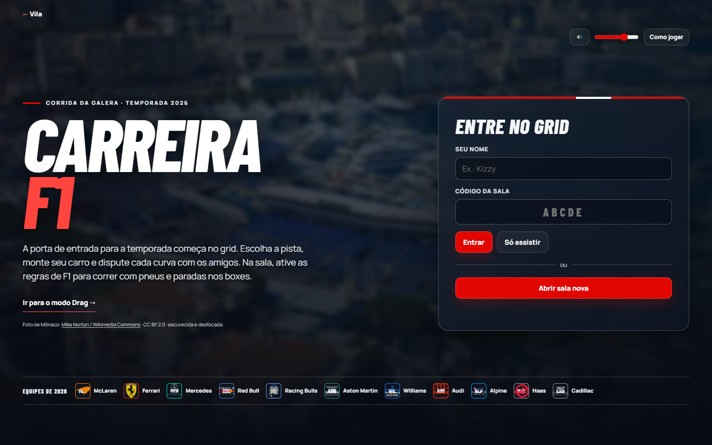
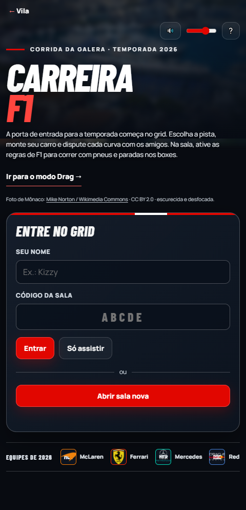
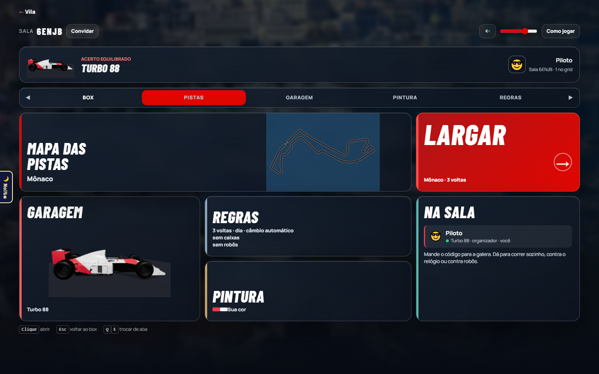
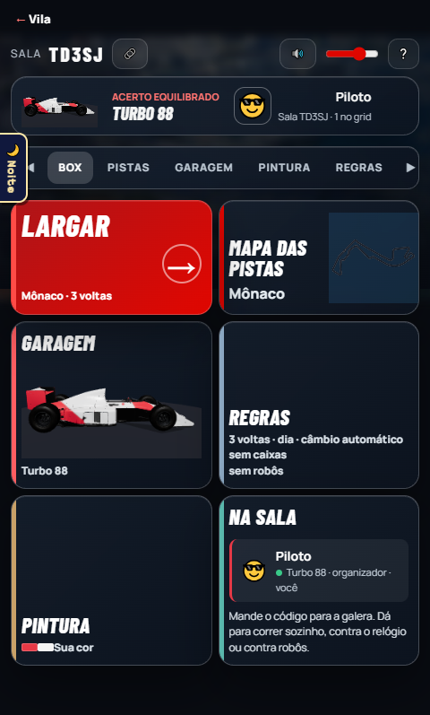

# Carreira F1: nova entrada da Corrida

## O que entrou nesta branch

- Recriei a entrada de `/corrida/` e a sala com uma identidade de Carreira F1: foto de Mônaco, tipografia forte, painéis translúcidos, cores das equipes e layout para desktop e celular. O topo mantém apenas `← Vila`.
- Preservei criar, entrar e assistir a salas, escolher pista, carro, pintura e regras, largar e acessar o modo Drag. Os recordes pessoais continuam nos cartões das pistas.
- Baixei os emblemas das 11 equipes de 2026 para `public/corrida/logos/`, com índice de cores e URLs de origem. O servidor entrega os PNGs por `/api/corrida/logo/:id`; sem imagem, a interface mostra a sigla colorida. `ferramentas/baixar-logos-f1.js --refresh` atualiza os arquivos.
- A pintura usa as cores do índice, e as garagens recebem essas cores quando uma corrida começa. Removi o render 3D da capa antiga, que deixou de ser necessário.
- Limitei o desfoque aos painéis parados do menu; a interface da corrida 3D não recebe `backdrop-filter`. Ajustei toque, viewport e preferência de movimento reduzido.

## Verificação

- `node --test tests/corrida*.test.js`: 44 testes passaram.
- `npx playwright test tests/e2e/corrida-carreira-f1.spec.js`: abre a página em 480 × 270, confere 11 logos locais, cria sala, percorre garagem e pintura, seleciona Mônaco e regras de F1 e larga.
- `git diff --check`: sem erros.
- Inspeção visual em desktop e em 480 × 270, sem erro de página nem rolagem horizontal.

## Fotos

| Tela | Desktop | Celular |
| --- | --- | --- |
| Entrada |  |  |
| Sala |  |  |

Foto de fundo: [Mike Norton, via Wikimedia Commons](https://commons.wikimedia.org/wiki/File:Monaco_Port_and_Track.jpg), CC BY 2.0, escurecida e desfocada. Emblemas: [TheSportsDB](https://www.thesportsdb.com/); cada URL de origem está no índice local.
